<p align="center">
  <picture>
    <source media="(prefers-color-scheme: dark)" srcset="docs/readme/banner.dark.png">
    
  </picture>
</p>

<p align="center">
  Агент читает условие ML-задачи и данные, сам строит признаки и модели, проверяет гипотезы на своей
  валидации и пишет файл с предсказаниями. Один и тот же код решает регрессию, бинарную и многоклассовую классификацию.
</p>

<p align="center">
  <!-- readme:buttons -->
  <a href="#запуск"><picture><source media="(prefers-color-scheme: dark)" srcset="docs/readme/cta-run.dark.png"></picture></a>
  <a href="docs/agent.md"><picture><source media="(prefers-color-scheme: dark)" srcset="docs/readme/cta-agent.dark.png"></picture></a>
  <a href="docs/README.md"><picture><source media="(prefers-color-scheme: dark)" srcset="docs/readme/cta-docs.dark.png"></picture></a>
  <!-- /readme:buttons -->
</p>

<p align="center">
  <!-- readme:status -->
  <a href="#результаты"><picture><source media="(prefers-color-scheme: dark)" srcset="docs/readme/badge-status-1.dark.png"></picture></a>
  <a href="#результаты"><picture><source media="(prefers-color-scheme: dark)" srcset="docs/readme/badge-status-2.dark.png"></picture></a>
  <br>
  <a href="#как-это-работает"><picture><source media="(prefers-color-scheme: dark)" srcset="docs/readme/badge-status-3.dark.png"></picture></a>
  <a href="LICENSE"><picture><source media="(prefers-color-scheme: dark)" srcset="docs/readme/badge-status-4.dark.png"></picture></a>
  <!-- /readme:status -->
</p>

<p align="center">
  <!-- readme:stack -->
  <picture><source media="(prefers-color-scheme: dark)" srcset="docs/readme/badge-stack-1.dark.png"></picture>
  <picture><source media="(prefers-color-scheme: dark)" srcset="docs/readme/badge-stack-2.dark.png"></picture>
  <br>
  <picture><source media="(prefers-color-scheme: dark)" srcset="docs/readme/badge-stack-3.dark.png"></picture>
  <picture><source media="(prefers-color-scheme: dark)" srcset="docs/readme/badge-stack-4.dark.png"></picture>
  <!-- /readme:stack -->
</p>

<p align="center">
  <!-- readme:nav -->
  <a href="#зачем-это"><picture><source media="(prefers-color-scheme: dark)" srcset="docs/readme/badge-nav-1.dark.png"></picture></a>
  <a href="#как-это-работает"><picture><source media="(prefers-color-scheme: dark)" srcset="docs/readme/badge-nav-2.dark.png"></picture></a>
  <a href="#попробовать-за-две-минуты"><picture><source media="(prefers-color-scheme: dark)" srcset="docs/readme/badge-nav-3.dark.png"></picture></a>
  <br>
  <a href="#результаты"><picture><source media="(prefers-color-scheme: dark)" srcset="docs/readme/badge-nav-4.dark.png"></picture></a>
  <a href="#запуск"><picture><source media="(prefers-color-scheme: dark)" srcset="docs/readme/badge-nav-5.dark.png"></picture></a>
  <a href="#устройство"><picture><source media="(prefers-color-scheme: dark)" srcset="docs/readme/badge-nav-6.dark.png"></picture></a>
  <a href="#ограничения"><picture><source media="(prefers-color-scheme: dark)" srcset="docs/readme/badge-nav-7.dark.png"></picture></a>
  <!-- /readme:nav -->
</p>

> **Файл с предсказаниями существует с первой минуты.** Каждая ступень каскада перезаписывает
> `submission.csv` только более сильным результатом, поэтому падение или нехватка времени оставляют
> последний валидный сабмит, а не ноль баллов.

## Зачем это

Платформа запускает решение на скрытых задачах, которые агент видит впервые: заранее неизвестны
тип задачи, метрика, формат вывода и структура данных. Ручная настройка под датасет невозможна, а
упавший или опоздавший запуск получает ноль.

Поэтому агент устроен как каскад со страховкой: сначала константный и быстрый сабмит, затем
поиск признаков, пул моделей и AutoGluon. Любая гипотеза — признак, преобразование таргета, смесь
моделей, постобработка — принимается, только если улучшает метрику задачи на собственной валидации.

## Как это работает

```mermaid
%%{init: {"theme":"base","themeVariables":{"primaryColor":"#ffffff","primaryTextColor":"#0b1f35","primaryBorderColor":"#ef3124","secondaryColor":"#eeeef0","tertiaryColor":"#f7f7f8","lineColor":"#8590a0","textColor":"#0b1f35","noteBkgColor":"#eeeef0","noteTextColor":"#4d5a6b","actorBkg":"#ffffff","actorBorder":"#ef3124","fontFamily":"Inter"}}}%%
flowchart LR
    T["task.md и данные"] --> P["Профиль задачи<br/>тип, метрика, формат"]
    P --> C["constant и quick LightGBM<br/>первый сабмит"]
    C --> E["AutoEDA<br/>детекторы и DSL признаков"]
    E --> K["k-fold LightGBM<br/>OOF-база"]
    K --> Pool["Пул рецептов<br/>CatBoost, XGBoost, ExtraTrees"]
    Pool --> AG["AutoGluon<br/>на фолдах схемы"]
    AG --> R["Ridge: модель<br/>и преобразование"]
    R --> F["Ансамбль, калибровка,<br/>постобработка"]
    F --> S[("submission.csv")]
```



- **Профиль задачи.** Тип, метрику и целевые колонки агент берёт из `sample_submission.csv`, словаря
  данных и текста задачи. Текст читает Qwen со строгим JSON; без LLM работают правила по тексту и
  данным.
- **Валидация под тест.** Схема фолдов выбирается по данным: по периодам, если test идёт после
  train; по группам, если в test новые объекты; иначе стратифицированный k-fold.
- **AutoEDA.** Детекторы находят зависимости, гипотезы записываются декларативными спеками DSL, и
  единый валидатор принимает только то, что улучшает модель на фолдах. Порог прироста калибруется
  по перемешанным копиям признаков.
- **Пул и ансамбль.** Рецепты пула обучаются на тех же фолдах в порядке ценности на единицу времени.
  Жадный ансамбль собирается на development-части OOF и проверяется на отложенной control-части.
- **Отдельное семейство Ridge.** Для регрессии Ridge сравнивает исходные признаки и
  `sign(x)·log1p(|x|)` и заменяет победителя, только если выигрывает больше 0,2% на тех же строках.

Подробно — в [устройстве агента](docs/agent.md).

## Попробовать за две минуты

В репозитории лежат две публичные задачи кейса: регрессия энергопотребления зданий и
классификация типов сетевых атак. Короткий прогон на регрессии:

```bash
cd solution
AGENT_TIME_LIMIT_SEC=900 AGENT_SAFETY_SEC=60 AGENT_PREDICT_RESERVE_SEC=120 \
  python3 solution.py ../data/regression/task.md
```

| Что смотреть | Где |
|---|---|
| Готовые предсказания | `submission.csv` рядом с `task.md` |
| Журнал экспериментов | `experiments.jsonl`: каждая гипотеза, её метрика и решение |
| Выбор финального источника | Лог в консоли: какая модель или смесь победила и почему |

Без `OPENAI_API_KEY` агент работает на правилах, с ключом подключает Qwen для чтения задачи и
гипотез признаков.

## Результаты

Полный каскад на двух публичных задачах, 3000 секунд и два CPU на запуск, два повтора. Оценка — на
отложенной части train: метки официального теста недоступны.

| Задача | Метрика итогового CSV | Holdout |
|---|---:|---|
| Энергопотребление зданий | RMSE **40,34** | 18 308 строк последнего года |
| Типы сетевых атак | Macro F1 **0,669** | 17 534 строки, стратифицированные 20% |

Экспериментальный исследовательский цикл `AGENT_RESEARCH_MODE=iterative` прироста не дал: RMSE
43,47 и Macro F1 0,642. Поэтому он выключен по умолчанию, а отчёт с отрицательным результатом
сохранён. Все запуски, время, память и стоимость API — в
[отчёте полного каскада](verification/alfa-full-cascade-results.md).

## Запуск

Нужен Python 3.12 и библиотеки из [списка организаторов](task/requirements.txt):

```bash
pip install -r solution/requirements.txt
python3 solution/solution.py /path/to/task.md
```

Для LLM задайте `OPENAI_API_KEY`, `OPENAI_BASE_URL` и `OPENAI_MODEL`. Архив для платформы
собирается из корневых модулей `solution/`:

```bash
cd solution && zip -j ../solution.zip solution.py task_profile.py models.py agent_utils.py eda_probe.py \
  fe_dsl.py fe_search.py eda_detectors.py pool.py linear_search.py research_search.py requirements.txt
```

Тесты, переменные окружения и тайм-менеджмент — в [устройстве агента](docs/agent.md).

## Устройство

```text
solution/       агент: точка входа solution.py и модули, которые попадают в ZIP
solution/tests  тесты на синтетике и публичных задачах
data/           две публичные задачи кейса
task/           задание организаторов, baseline.py и разрешённые библиотеки
verification/   стенды сравнения и отчёты замеров
docs/           устройство агента и оглавление
```

| Документ | Что внутри |
|---|---|
| [Устройство агента](docs/agent.md) | Каскад, профиль задачи, валидация, журнал, тайм-менеджмент, тесты |
| [Полный каскад](verification/alfa-full-cascade-results.md) | Сравнение режимов с AutoGluon на публичных задачах |
| [Исследовательский цикл](verification/alfa-research-results.md) | Пилот iterative-режима и его ограничения |
| [Задание](task/README.md) | Условие кейса и формат сдачи |
| [Оглавление](docs/README.md) | Все страницы |

## Ограничения

- **Оценка — на отложенной части train.** Метки скрытых задач недоступны, два повтора не дают
  статистической значимости и не гарантируют перенос на новые задачи.
- **Время ограничено платформой.** На классификации в одном из повторов общий сторож остановил
  каскад до конца AutoGluon, и в зачёт пошёл резервный сабмит.
- **Исследовательский цикл экспериментальный.** На регрессии короткий пилот дал меньшую ошибку, на
  классификации — ухудшение; по умолчанию используется прежний режим.
- **Ridge — первая версия.** Он работает на 20–100 000 строк и до 200 числовых признаков и не
  использует категориальные признаки.

<p align="center">
  <picture><source media="(prefers-color-scheme: dark)" srcset="docs/readme/mark.dark.png"></picture>
  <br>
  <sub>Команда GoatWhistle, хакатон Альфа-Банка AlfaFuture, кейс «AI-агент для разработки ML-моделей», 2026. Лицензия <a href="LICENSE">MIT</a>.</sub>
</p>
